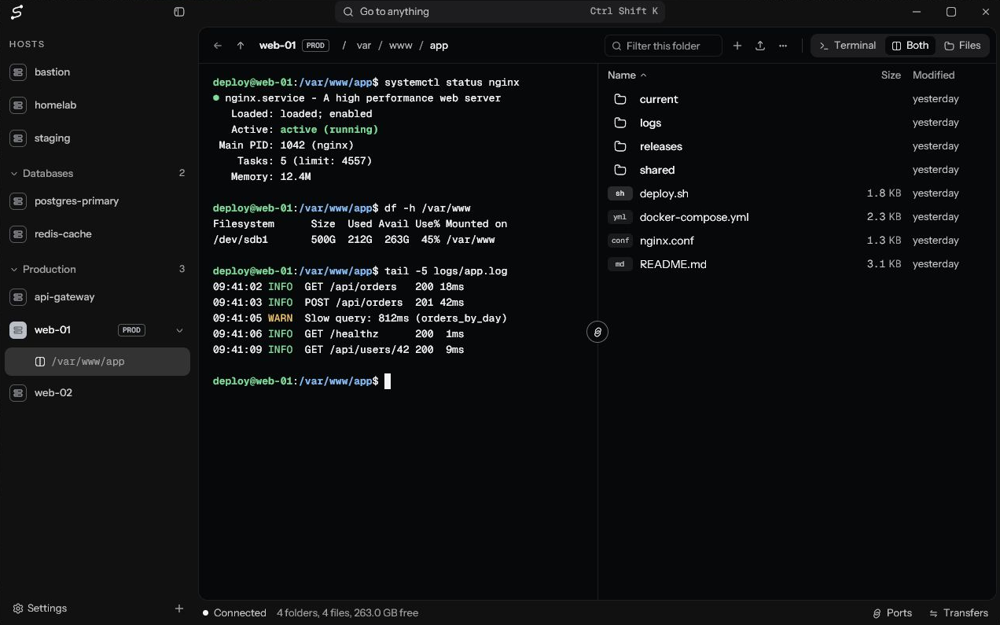

# shcp

ssh and sftp client for Windows written in Rust with [gpui](https://gpui.rs).



- Terminal and SFTP browser, separately or side by side
- Tabs and split terminals share one SSH connection per host. Tabs reopen when you start the app again
- Group and reorder hosts in the sidebar, with tags for production and staging
- Search terminal output, open links with Ctrl+click, and save session logs
- Automatic reconnection without losing terminal output, and resumable file transfers
- Preview files, change permissions, and edit remote files in your local editor
- Drop files or paste screenshots into the terminal to upload them
- Key, SSH agent, password and keyboard-interactive authentication, including two-factor prompts
- Reads `~/.ssh/config`, including `Include`, `Match`, `ProxyJump` and `ProxyCommand`
- Local and remote port forwarding, SOCKS proxies, and optional SSH agent forwarding
- Saved commands and startup commands per host
- Custom shortcuts, tab names, and themes from [Open VSX](https://open-vsx.org) or VS Code theme files.
- Import and export hosts and settings.

## Build

Needs Rust and the Visual Studio C++ build tools.

```
cargo build --release -p shcp-app
```

The executable is `target\release\shcp.exe`.

## Where files are stored

On this PC:

| What                                                                 | Where                                      |
| -------------------------------------------------------------------- | ------------------------------------------ |
| Settings                                                             | `%APPDATA%\shcp\shcp\config\settings.toml` |
| Hosts added in the app                                               | `%APPDATA%\shcp\shcp\config\hosts.toml`    |
| Tabs to reopen at startup                                            | `%APPDATA%\shcp\shcp\config\tabs.toml`     |
| Themes                                                               | `%APPDATA%\shcp\shcp\config\themes\`       |
| Logs, and crashes in `crash.log`                                     | `%LOCALAPPDATA%\shcp\shcp\data\logs\`      |
| Terminal logs of the hosts you turned them on for                    | `%LOCALAPPDATA%\shcp\shcp\data\sessions\`  |
| Copies of files open in your editor (removed at startup after a day) | `%LOCALAPPDATA%\shcp\shcp\data\edit\`      |
| SSH hosts, read only                                                 | `~\.ssh\config`                            |
| Known host keys                                                      | `~\.ssh\known_hosts`                       |
| Passwords and key passphrases you chose to remember                  | Windows Credential Manager                 |

On the server:

| What                                                                                           | Where                  |
| ---------------------------------------------------------------------------------------------- | ---------------------- |
| Screenshots and files pasted or dropped on a terminal (removed at the next paste after 7 days) | `~/.cache/shcp/paste/` |
