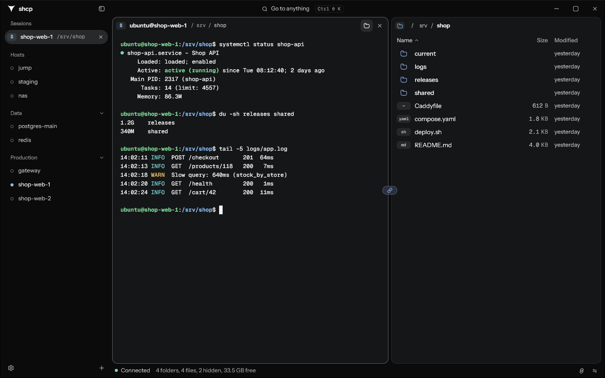

# shcp

An SSH and SFTP client for Windows, written in Rust with [gpui](https://gpui.rs).



## Why

I built shcp for my day job, i wanted a lightweight SSH client for Windows with
a file browser that follows the shell I am working in.

As I move around in a terminal the file browser beside it follows my current folder. I can preview
files, change permissions, open remote files in my local editor and save them back, drop a file
or paste a screenshot onto the terminal to upload it, with its path typed for me.

With tmux on the server, every tab and split runs in its own tmux session, without me ever touching
tmux. Closing the app, dropping the connection or switching PC brings back the same tabs, splits
and output, and the tabs are shared live. If the server restarts, the shells come back in the folders they were in. Lost connections come back by
themselves, and interrupted transfers resume where they stopped.

It works with the SSH setup I already have. It reads `~/.ssh/config` (`Include`, `Match`,
`ProxyJump`, `ProxyCommand`), uses my keys or the SSH agent, answers password and two-factor
prompts, and runs every tab, port forward and SOCKS proxy over one connection per host. Hosts sit in
groups in the sidebar, a command palette (Ctrl+Shift+K) takes me to any host, tab or command, and
themes come from [Open VSX](https://open-vsx.org) or VS Code. It is a single native `.exe`, drawn
on the GPU with gpui, that updates itself.

## Build

Needs Rust and the Visual Studio C++ build tools.

```
cargo build --release -p shcp-app
```

The executable is `target\release\shcp.exe`.

## Where files are stored

On this PC:

| What                                                                 | Where                                      |
| -------------------------------------------------------------------- | ------------------------------------------ |
| Settings                                                             | `%APPDATA%\shcp\shcp\config\settings.toml` |
| Hosts added in the app                                               | `%APPDATA%\shcp\shcp\config\hosts.toml`    |
| Tabs to reopen at startup                                            | `%APPDATA%\shcp\shcp\config\tabs.toml`     |
| Themes                                                               | `%APPDATA%\shcp\shcp\config\themes\`       |
| Logs, and crashes in `crash.log`                                     | `%LOCALAPPDATA%\shcp\shcp\data\logs\`      |
| Terminal logs of the hosts you turned them on for                    | `%LOCALAPPDATA%\shcp\shcp\data\sessions\`  |
| Copies of files open in your editor (removed at startup after a day) | `%LOCALAPPDATA%\shcp\shcp\data\edit\`      |
| SSH hosts, read only                                                 | `~\.ssh\config`                            |
| Known host keys                                                      | `~\.ssh\known_hosts`                       |
| Passwords and key passphrases you chose to remember                  | Windows Credential Manager                 |

On the server:

| What                                                                                           | Where                  |
| ---------------------------------------------------------------------------------------------- | ---------------------- |
| Screenshots and files pasted or dropped on a terminal (removed at the next paste after 7 days) | `~/.cache/shcp/paste/` |
| Running terminals, in memory until the server restarts                                         | tmux socket `shcp`     |
